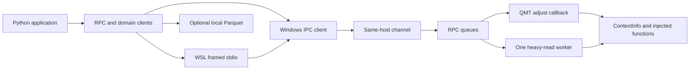

# Architecture

## Owners

| Modules | Responsibility |
|---|---|
| `client`, `config`, `data_frames` | Explicit configuration, one-shot request envelope and client deserialization |
| `data_client`, `local_cache` | Market API and client-only Parquet coordination |
| `trader_client`, `credit_client` | Trading and credit client interfaces |
| `client_async`, `client_callbacks` | One serialized async worker, silent polling baseline and callback ordering |
| `option_analytics`, `option_analytics_client.OptionsClient`, `option_order_type` | Local option math, quote coordination and enum mapping |
| `transports/pipe_server` | Host listener, request draining and connection-owned replies |
| `transports/pipe_native` | Shared message I/O and wire validation |
| `transports/pipe_client` | Client connections and total request deadlines |
| `transports/pipe_relay`, `pipe_relay_transport` | Length-prefixed stdio framing and client subprocess lifecycle |
| `qmt_injected`, `strategy_runtime` | Capture native globals and own strategy lifecycle |
| `rpc_service`, `rpc_dispatch`, `account_scope` | Scheduling, account isolation, write deduplication and routing |
| `rpc_trade_handlers`, `rpc_settlement`, `order_watch` | Execution requests and bounded reconciliation against native identities |
| `rpc_credit`, `rpc_account_handlers`, `rpc_native` | Main-thread native account/credit queries |
| `rpc_market_handlers`, `adapters/market_*` | Composed ticks, bars, dividends, metadata, options, financial and formula domains |
| `adapters/order_gateway`, `order_queries`, `position_bigqmt` | Native execution and independent account snapshots |
| `rpc_codec`, `models`, `native_time` | Wire conversion and native snapshot/time contracts |
| `qmt_launcher` | Optional external Windows desktop launcher, outside the host module graph |

## Scheduling and lifecycle

The local listener accepts connections. `adjust` drains requests; all account, credit and order methods are hard-routed to the callback thread. Large/history market reads and formula execution use one worker. Worker results return through the original connection object, so recycled integer handles cannot receive stale replies.

Deadlines are assigned when requests enter the server. Expired orders are refused, with another check immediately before native dispatch. Cancellation is allowed to make progress after its queue deadline. Native requests already inside QMT cannot be force-aborted by Python. A live worker prevents replacement of the runtime during reinitialization.

Each client thread owns its native connection or relay process. Unknown write outcomes never trigger a transparent resend. Async order responses precede matching polling events; unrelated events can still be delivered. A trader instance subscribes to one account type; use separate instances for separate callback scopes.

## Single-file build

The builder traverses the relative-import graph from `strategy_runtime` and `qmt_injected`. Each source module becomes a real `def _mod_N():` body in the GBK artifact. A private loader executes those bodies in separate module namespaces and captures the QMT globals before loading the runtime. It does not install a global import hook or overwrite `sys.modules`.

Source modules remain independently testable. The manifest records SHA-256 hashes of every included source module and the complete generated file. All client, relay and desktop launcher modules are excluded from the host graph. Shared message I/O has its own owner, and runtime boundary checks enforce this dependency direction.
